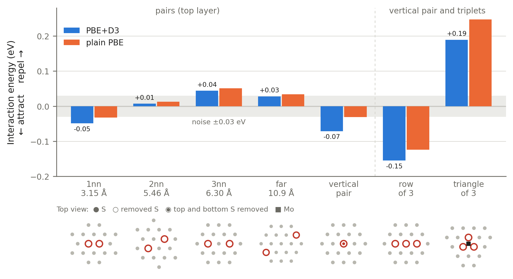

# How Pt clusters nucleate at sulfur vacancies on MoS₂

First-principles (DFT, VASP) study of Ptₙ at single and neighbouring S vacancies on monolayer MoS₂, built on the experiment of Yan et al., *Adv. Funct. Mater.* 35, 2423262 (2025).

Throughout this file, **G1–G3** label the three gaps declared under [The gap](#the-gap). Every research question, hypothesis, step and output carries the label of the gap it serves.

## Status

Last updated 2026-10-15. Steps 01–04 done. Step 05 (full search, 358 screening relaxations on 2 fat96 nodes) built, ready to submit.

| Step | Folder | State |
|---|---|---|
| Literature review and scope | `Literatures/` | Done (12 papers; 4 only skimmed; no SI read) |
| 01 Convergence | `01_convergence/` | **Done** (2026-10-12): 450 eV; Γ adequate for the 6×6 sheet |
| 02 Lattice constant and references | `02_references/` | **Done** (2026-10-12): a(MoS₂) = 3.1514 Å; a(Pt) = 3.926 Å |
| 03 Benchmarks | `03_benchmarks/` | **Done** (2026-10-13): Pt₁ in vacancy 5.89 eV (Li 2017: 6.08); site ranking on pristine matches; Γ/450 eV confirmed on the 6×6 cell (≤ 1.6 meV) |
| 04 Vacancy pairs | `04_vacancy_pairs/` | **Done** (2026-10-15): pairs interact by ≤ 0.07 eV (H0 holds); row of 3 attracts (−0.16 eV), triangle repels (+0.19 eV) |
| 05 Ptₙ, n = 1–4 | `05_Ptn_small/` | **Built** (2026-10-15): full search, 358 screening starts + ~60 refinements, 2 fat96 nodes |
| 06 Ptₙ, n = 6, 9, 13 | `06_Ptn_large/` | Planned |
| 07 Control | `07_control/` | Planned |
| 08 Hydrogen adsorption | `08_hydrogen/` | Planned |
| Kinetics (NEB); nanoparticle stand-in | — | Deferred |

## Introduction

**MoS₂ and its vacancies.** Monolayer MoS₂ is a sheet three atoms thick: a plane of Mo between two planes of S. The flat basal plane is chemically inert. Removing an S atom leaves a sulfur vacancy that exposes three Mo atoms, and this is the most common defect in the material.

**Defect anchoring.** A metal atom binds weakly to the perfect basal plane and moves easily, so metal atoms clump into particles. A vacancy holds a metal atom much more strongly. Using vacancies as fixed sites for metal atoms is called defect anchoring.

**Why Pt size matters.** Pt is the best hydrogen-evolution catalyst but is scarce. Spreading it as single atoms uses every atom, but a single atom is not automatically the most active form. Activity is commonly judged by ΔG_H*, the free energy of an adsorbed H atom; the closer to zero, the better.

**The experiment we build on.** Yan 2025 creates S vacancies with a 5 s Ar plasma (10–15% of S sites), deposits Pt from H₂PtCl₆ solution, and anneals at 300 °C. More Pt solution gives larger Pt:

| Species | Size | Overpotential at 10 mA cm⁻² | DFT ΔG_H* |
|---|---|---|---|
| Single atoms | 1 atom | 202 mV | 0.71 eV |
| Clusters | < 1 nm (roughly 5–20 atoms) | 94 mV | −0.01 eV |
| Nanoparticles | ~1.9 nm (roughly 120–240 atoms) | 259 mV | −0.50 eV |

Clusters are the best catalyst. The paper does not explain why clusters form. (Atom counts are our estimates from bulk Pt density.)

**Why put Pt on a support at all.** Only surface atoms of Pt catalyse the reaction, so a block or large particle wastes most of its atoms. Making Pt very small exposes more of them, but small Pt merges into larger particles unless something holds it apart. Every practical Pt catalyst is therefore Pt on a support; the commercial one is Pt nanoparticles on carbon.

**Why MoS₂ as the support.**

- **Its vacancies pin Pt in place**, which is the defect anchoring described above.
- **It is not a passive holder.** MoS₂ edges and S vacancies are themselves active for HER, and the support can change how strongly Pt binds hydrogen. Yan attributes the clusters' activity to this; gap G2 tests it.
- **It is a clean model system.** A flat, one-layer crystal lets every Pt atom be imaged and a single flake be measured on a chip, which is hard on carbon powder.

MoS₂ is not obviously the better support for a real electrolyser: its basal plane conducts poorly compared with carbon, and Yan's results are from single flakes, not a device. Much of the interest is in linking structure to activity atom by atom.

**Why it matters.**

- **Less Pt for the same hydrogen.** Hydrogen from water electrolysis needs a hydrogen-evolution catalyst, and Pt is the best one but scarce and costly. Yan's clusters reach the highest activity at very low Pt content, so knowing how to make clusters on purpose is a direct route to using less Pt.
- **A single atom in a vacancy is a double loss.** An empty S vacancy is itself active for HER (ΔG_H* ≈ −0.06 eV), but a Pt atom filling it is not (0.83 eV; Li 2017). Dispersing Pt as far as possible can therefore spend Pt and remove an active site at once. Where clusters form instead decides the activity.
- **Size is currently set by trial and error.** Yan tunes it with the volume of Pt solution. If the arrangement of vacancies decides whether atoms stay single or nucleate clusters, then vacancy density becomes a second, designable control.

**Where the result applies.**

- **Synthesis guidance.** A map of which vacancy arrangements nucleate clusters translates into a target vacancy density, which is set by plasma time, to pair with a given Pt dose.
- **Direct comparison with experiment.** The same groups can test the prediction with the on-chip single-flake method they already use.
- **Beyond this system.** The approach (growth at single versus neighbouring vacancies) carries over to other metals and other dichalcogenides. Whether the conclusions carry over is not known.

## Literature review

Full notes, numbers and sources: [`Literatures/literature_review.md`](Literatures/literature_review.md).

| Paper | What it did | What it leaves open |
|---|---|---|
| **Yan 2025** (anchor) | Made Pt single atoms, clusters and nanoparticles on plasma-treated MoS₂; measured HER on single flakes; one ΔG_H* per species | Why each size forms; a control for its mechanism; realistic cluster models |
| Li 2017 | STEM + DFT of one Pt atom: binding 6.08 eV in an S vacancy, ~3 eV to escape, 0.75 eV to hop into an adjacent empty vacancy; Pt in a vacancy is inactive for HER | More than one Pt atom |
| Saidi 2015 | Step-by-step growth of Ptₙ (n ≤ 12) on pristine MoS₂; flat → 3D at n = 5; critical nucleus of one atom | Any defect |
| Shi 2018 | Ptₙ structures up to n = 20 by genetic algorithm, matched to STEM atom by atom | Any defect |
| Shi 2022 | Ptₙ at a grain boundary: the defect stabilises clusters up to ~10 atoms, then the effect fades | S vacancies |
| Wang 2018 | Experiment: Pt clusters seed at grain-boundary dislocations | S vacancies; energetics |
| Özaydın 2014; Wu 2017; Ramírez 2022 | One Pt atom or very small clusters on pristine MoS₂; one Pt in one vacancy | Clusters at vacancies |
| Sensoy 2017; Komsa 2013; Le 2014 | How S vacancies interact and move: weak interaction, isolated vacancies immobile (2.2–2.3 eV) | Anything involving Pt |

### The gap

One point per paper:

- **Yan 2025** observes the size sequence but computes neither the anchoring nor the growth.
- **Li 2017** stops at one Pt atom.
- **Saidi 2015** and **Shi 2018** grow clusters only on the defect-free surface.
- **Shi 2022** and **Wang 2018** treat grain boundaries, not point vacancies.
- **Özaydın 2014, Wu 2017, Ramírez 2022** do not go beyond single atoms or defect-free sheets.
- **Sensoy 2017, Komsa 2013, Le 2014** describe the vacancies but put nothing on them.

**Overall gap:** nobody has computed how Pt clusters of two or more atoms bind and grow at S vacancies, or at neighbouring vacancies, on MoS₂.

In the anchor paper this appears as three specific gaps:

| Gap | Statement |
|---|---|
| **G1 — Nucleation** | The atom → cluster → particle sequence is unexplained. A Pt atom in a vacancy (~6.1 eV) is bound more strongly than in any cluster on pristine MoS₂ (up to ~4.1 eV per atom), and vacancies far outnumber Pt atoms, so single atoms should win. Yet clusters form. |
| **G2 — Mechanism control** | The claim "electron transfer from MoS₂ to the cluster gives ΔG_H* ≈ 0" is never tested against the same cluster without the substrate or without the vacancy. |
| **G3 — Model realism** | Activity is computed on an idealised Pt₁₃ icosahedron at one H site. Real Pt₁₃ on MoS₂ is a two-layer (111) structure (Shi 2018), and no model includes the vacancy under the cluster. |

### Research questions

| | Question | Gap | Hypothesis |
|---|---|---|---|
| **RQ1** | At an isolated S vacancy, does a second Pt atom join the anchored one or prefer a fresh vacancy? | G1 | **H1.** It prefers a fresh vacancy: isolated vacancies give single atoms. |
| **RQ2** | Do neighbouring vacancies (pairs, rows, triangles) make small clusters more stable than separated atoms? | G1 | **H2.** Yes: patches nucleate clusters. |
| **RQ3** | How far does the vacancy's influence reach as the cluster grows? | G1 | **H3.** It fades after the first few atoms, as at grain boundaries. |
| **RQ4** | Is the near-zero ΔG_H* of clusters caused by the substrate and the vacancy, or by cluster size alone? | G2 | **H4.** Charge transfer and H binding depend on substrate and vacancy, not on size alone. |
| **RQ5** | Do realistic, vacancy-anchored clusters bind H closer to ΔG_H* = 0 than single atoms? | G3 | **H5.** Yes, across several H sites. |

**Novelty**

| | Contribution | Gap |
|---|---|---|
| **N1** | First Ptₙ growth study at S vacancies on MoS₂ | G1 |
| **N2** | Neighbouring vacancies treated explicitly; at 10–15% vacancy density about half of all vacancies have a vacant neighbour | G1 |
| **N3** | A testable nucleation mechanism tied to an experimental sequence | G1 |
| **N4** | The control the anchor paper lacks, separating cluster size, substrate and vacancy | G2 |
| **N5** | ΔG_H* on vacancy-anchored, structure-searched clusters instead of an idealised shape | G3 |

Limits on the novelty claim: "not found" rests on web searches, and a cited-by check on Li 2017 and Shi 2018 is still to do. The equivalent study exists for graphene (Pt clusters at carbon vacancies, ~2012), so the contribution is the MoS₂-specific physics in N2 and N3, not the general idea.

**If the hypotheses fail.** If H1 and H2 are both false (separated atoms win everywhere), clusters cannot come from energetics at vacancies; that points to uneven Pt supply or passivated vacancies and still answers G1. If H4 is false (the free cluster already gives ΔG_H* ≈ 0), the substrate explanation is not needed; that answers G2.

### Scope

The scope is exactly what G1–G3 require.

| In scope | Needed for |
|---|---|
| Ptₙ (n = 1–13) at a single vacancy and at vacancy pairs, rows and triangles: structures, binding and addition energies | G1 |
| Fresh-vacancy versus join-the-cluster energy comparison | G1 |
| Same cluster free, on pristine MoS₂ and on a vacancy; charge transfer | G2 |
| ΔG_H* at several sites on the realistic structures | G3 |

**Size range.** Our largest size, Pt₁₃, is in the cluster range. The project covers the single atom → cluster step; the cluster → nanoparticle step stays open.

**Not in the current scope**

- Nanoparticles (~1.9 nm; too large for a structure search in this cell)
- The wet route from [PtCl₆]²⁻; solvent, pH and electrode potential; HER barriers
- Long-time dynamics and machine-learned potentials
- Other TMDs and metals; graphene

**Deferred:** kinetics by NEB (would strengthen G1); a nanoparticle stand-in such as a Pt(111) slab or a ~38-atom particle (large-size limit for G3).

## Methods

### Settings

| Choice | Value | Note |
|---|---|---|
| Code | VASP 5.4.x | Same as all reference papers |
| Cell | 6×6 MoS₂ monolayer (108 atoms), 24 Å cell height | Keeps Pt₁₃ > 10 Å from its image |
| Functional | PBE + D3 (Becke–Johnson damping), spin-polarised | Matches Yan 2025, which says only "DFT-D3" |
| POTCARs | `Mo_pv`, `S`, `Pt` | `Mo_sv` is the alternative |
| Cutoff / k-points | 450 eV; Γ for 6×6 relaxations; MoS₂ primitive 15×15×1; bulk Pt 21×21×21 | Fixed by step 01; confirmed on the 6×6 cell in step 03 (binding within 1.6 meV at 550 eV, 2×2×1, 3×3×1) |
| Convergence | Forces < 0.02 eV/Å; dipole correction | Pt on one side only |
| Electronic | `ALGO = Normal`; `AMIX = 0.2`, `BMIX = 0.0001` (+ magnetic counterparts); `MAGMOM` Mo 0.5, S 0, Pt 1 μB; `NELM = 200` | `ALGO = Fast` diverged in the slabs; isolated atoms use `ALGO = All` |
| Lattice | Fixed at the fitted pristine constant | 3.1514 Å (step 02) |
| Pt reference | Isolated atom and bulk Pt | Bulk decides "will it sinter" |

**Substrates** (vacancies in the top S layer only)

| Label | Description | Serves |
|---|---|---|
| P | Pristine | G1 reference, G2 control |
| V1 | Single vacancy | G1 (H1), G2, G3 |
| V2 | Two adjacent vacancies | G1 (H2) |
| V2-far | Two vacancies at second-neighbour distance | G1 control for V2 |
| V3-row | Three in a line | G1 (H2) |
| V3-tri | Three in a triangle (around one Mo; around a hollow) | G1 (H2), G3 |

**Quantities**

| Quantity | Definition | Serves |
|---|---|---|
| Binding energy per atom | [E(sub) + n·E(Pt) − E(Ptₙ/sub)] / n | G1 |
| Addition energy | E(Ptₙ₋₁/sub) + E(Pt) − E(Ptₙ/sub), compared with one Pt in a fresh V1 | G1 (H1–H3) |
| Energy decomposition | MoS₂ deformation + Pt–Pt + metal–support (Saidi 2015) | G1, G2 |
| Charge transfer | Bader charges on Pt, one scheme throughout | G2 (H4) |
| ΔG_H* | ΔE_H + 0.24 eV | G3 (H5), G2 |

### Design overview

| Step | What | Size | Serves | Done when |
|---|---|---|---|---|
| 01 | Cutoff and k-mesh convergence on small cells | 34 single points | All | Settings converged |
| 02 | MoS₂ lattice constant; bulk Pt, Pt atom, S atom | 10 jobs | All | Lattice constant fitted |
| 03 | 6×6 benchmarks: P, V1, Pt₁ on three pristine sites, Pt₁ in V1 | 6 relaxations | All | Pt in V1 within ~0.2 eV of Li 2017 |
| 04 | Vacancy pair and triplet energies (1st, 2nd, 3rd, far, vertical pair; row and triangle of 3), fixed cell | 7 relaxations | G1 | Random-vacancy model confirmed or revised |
| 05 | Ptₙ, n = 1–4, on P, V1, V2_1nn, V3_row, V3_tri, by full symmetry-reduced search; addition-energy analysis | 358 loose + ~60 standard relaxations | G1 (H1, H2) | Lowest structure per (n, substrate) found |
| 06 | n = 6, 9, 13 on P, V1 and one patch, from Shi 2018 structures plus short AIMD annealing | ~50 relaxations | G1 (H3), G3 | Lowest structures found |
| 07 | Control: same cluster (n = 1, 4, 6, 13) free, on P, on V1; Bader charges | ~12 jobs | G2 (H4) | Figure F3 |
| 08 | ΔG_H* at 3–5 sites on the most stable Pt₁, Pt₄, Pt₆, Pt₁₃ | ~40 jobs | G3 (H5) | Figure F4 |

Pt₁₃ as the largest size is the current assumption; stopping at Pt₆ would shorten step 06.

### Step 01 — Convergence

All single points on fixed geometries.

| Subfolder | Varies | System | Fixed at |
|---|---|---|---|
| `encut_MoS2/encut_350` … `encut_600` | Cutoff | MoS₂ primitive cell (3 atoms) | 15×15×1 |
| `encut_Pt_bulk/encut_350` … `encut_600` | Cutoff | fcc Pt (1 atom) | 15×15×15 |
| `kpts_MoS2/k_06` … `k_18` | k-mesh k×k×1 | MoS₂ primitive cell | 450 eV |
| `kpts_Pt_bulk/k_09` … `k_21` | k-mesh k×k×k | fcc Pt | 450 eV |
| `encut_binding/encut_*/{V1, Pt1_V1}` | Cutoff | 3×3 MoS₂ with one S vacancy, with and without Pt; Pt reference = `encut_Pt_bulk` at the same cutoff | 4×4×1 |

**Validation targets**

- Energy per atom within 1 meV of the largest setting (`encut_*`, `kpts_*`).
- Pt binding energy within 20 meV of the largest cutoff (`encut_binding`). Energy differences usually converge sooner than totals, so this test decides the cutoff if the two disagree.

**Checks**

- Γ-only on the 6×6 supercell samples the same points as a 6×6×1 mesh on the primitive cell. So `k_06` against `k_12` and `k_18` shows directly whether Γ-only is adequate for the pristine sheet.
- `encut_binding` uses an unrelaxed 3×3 cell; only the change with cutoff matters, not the value.

### Step 02 — Lattice constant and references

| Subfolder | System | Gives |
|---|---|---|
| `MoS2_ascan/a_3.14` … `a_3.20` | MoS₂ primitive cell, 7 lattice constants | Equilibrium lattice constant |
| `Pt_bulk` | fcc Pt, cell relaxation at 600 eV | Pt lattice constant |
| `Pt_atom` | Pt atom in a 14×15×16 Å box, triplet | Atom reference |
| `S_atom` | S atom, same box, triplet | S reference for vacancy formation |

**Validation targets:** MoS₂ lattice constant near the PBE literature value of 3.18 Å (D3 is expected to shorten it slightly); Pt cohesive energy near the experimental 5.84 eV.

**Checks**

- After the bulk relaxation, `run_all.pbs` builds and runs `Pt_bulk/static` at the production cutoff, so the bulk energy matches everything else.
- The Pt atom is forced to a triplet. Atomic references are delicate in PBE; bulk Pt is the safer reference for conclusions.

### Step 03 — Benchmarks

| Subfolder | System | Gives |
|---|---|---|
| `P` | 6×6 MoS₂, pristine (108 atoms) | Substrate P |
| `V1` | 6×6 with one top-layer S removed | Substrate V1 |
| `Pt1_P_Mo-top`, `Pt1_P_S-top`, `Pt1_P_hollow` | One Pt on three pristine sites | Binding on pristine |
| `Pt1_V1` | One Pt in the S vacancy | The benchmark |

**Validation targets**

| Quantity | Formula | Compare with |
|---|---|---|
| Pt₁ binding in vacancy | E(V1) + E(Pt atom) − E(Pt/V1) | Li 2017: 6.08 eV (**pass if within ~0.2 eV**) |
| Pt₁ binding, pristine | E(P) + E(Pt atom) − E(Pt/P) | Li 2017: 3.71 / 3.22 / 3.17 eV; Saidi 2015: 2.83 / 2.20 / 2.25 eV (Mo-top / S-top / hollow) |
| S-vacancy formation | E(V1) + E(S atom) − E(P) | Le 2014: 5.85 eV |

Li 2017 used PBE-D2 and Saidi 2015 plain PBE, so our PBE-D3 values should fall near Li's and above Saidi's.

**Checks**

- **Memory and timing:** `test_one.pbs` relaxes `Pt1_V1` alone and writes an early report after the first ionic step (memory, time per SCF step). `run_all.pbs` (2 nodes) can be submitted once that looks fine; it leaves `Pt1_V1` to the test.
- **D3 versus plain PBE:** D3 overbinds bulk Pt (cohesive energy 6.29 eV against 5.84 eV experiment), which favours Pt–Pt over Pt–substrate bonding and could bias G1. D3 is a pure additive term, so the plain-PBE energy at the same geometry is E0 − Edisp; `collect.py` prints every binding energy both ways at no extra cost. If a conclusion changes between the two, the key structures are relaxed again with plain PBE.
- **Confirmation on the real cell:** single points of relaxed `V1` and `Pt1_V1` at the next cutoff up and at 2×2×1 and 3×3×1. The binding energy should change by less than 20 meV.
- The pristine sheet should come out non-magnetic.

### Step 04 — Vacancy pairs

| | Question | Gap | Hypothesis |
|---|---|---|---|
| **Step 04** | Do S vacancies attract, repel or ignore each other in our setup? The literature splits (Sensoy 2017: repel; Komsa 2013, Le 2014: weakly attract), all within 0.2 eV. | G1 (input to H2) | **H0.** The interaction is weak (≤ 0.2 eV per vacancy), so vacancies sit at random, which gives 47–74% of vacancies a vacant neighbour at 10–20% density. |

| Subfolder | Removed S (top layer unless stated) | Separation from the central vacancy |
|---|---|---|
| `V2_1nn`, `V2_2nn`, `V2_3nn` | 2 | 3.15, 5.46, 6.30 Å |
| `V2_far` | 2 | 10.92 Å (largest in the 6×6 cell; checks the isolated limit) |
| `V2_vert` | Top and bottom S at the same site | — (Li 2017: Pt binds 5.74 eV here) |
| `V3_row` | 3 in a line | 3.15, 6.30 Å |
| `V3_tri` | The 3 top S bonded to one Mo | 3.15 Å each |

**Quantity.** E_int = E(V2) + E(P) − 2 E(V1) for pairs and E(V3) + 2 E(P) − 3 E(V1) for triplets; negative means attraction. `run_all.pbs` prints it at the end, with and without D3, using `P` and `V1` from step 03.

**Choices.** Fixed cell at a = 3.1514 Å: VASP 5.4.4 cannot relax the cell in-plane only, and 2–3 vacancies among 72 S change the lattice little. The row and triangle are also step-05 substrates. No separate test job: the settings are those of `03_benchmarks/V1`, which ran cleanly.

**Cost.** Empty vacancies need 60–76 SCF steps from scratch; 3.5–10.8 h per relaxation (12–39 ks), 27 h for all 7 on 2 nodes; ≤ 0.6 GB per rank.

### Step 05 — Ptₙ, n = 1–4 (full search)

| | Question | Gap | Hypothesis |
|---|---|---|---|
| **RQ1** | At an isolated S vacancy, does a second Pt join the anchored one or prefer a fresh vacancy? | G1 | **H1.** It prefers a fresh vacancy. |
| **RQ2** | Do neighbouring vacancies make small clusters more stable than separated atoms? | G1 | **H2.** Yes. |

**Substrates.** `P`, `V1` (step 03); `V2_1nn`, `V3_row`, `V3_tri` (step 04 arrangements, rebuilt from ideal positions).

**Starts** (`setup.py`, all automatic)

| Rule | Choice | Why |
|---|---|---|
| Sites | Vacancy, Mo-top, hollow, S-top within 3.3 Å (in-plane) of any vacancy; around one Mo on `P` | One shell around the patch |
| n = 1 | Every distinct site | Maps where a single Pt sits around each patch |
| n ≥ 2 | Vacancies filled first: min(n, number of vacancies) Pt in vacancies | Filling a vacancy gains ~2.5 eV over a surface site (step 03) |
| Connectivity | Pt–Pt ≤ 3.7 Å at the starting heights | Clusters, not scattered atoms |
| Close sites | Sites 1.82 Å apart allowed; the upper Pt is raised until every Pt–Pt ≥ 2.5 Å | Gives compact and 3D clusters directly |
| Duplicates | Removed exactly with the substrate's symmetry operations (216 for `P`, 6 for `V1`, 2 for the pair and row, 6 for the triangle) | Each distinct start once |
| Already done | Pt₁ on `P` (3 sites) and Pt₁ in `V1`, from step 03 | Not repeated |

| Substrate | n = 1 | n = 2 | n = 3 | n = 4 | Total |
|---|---|---|---|---|---|
| `P` | (3, step 03) | 8 | 34 | 101 | 143 |
| `V1` | 3 (+1, step 03) | 3 | 14 | 43 | 63 |
| `V2_1nn` | 12 | 1 | 11 | 83 | 107 |
| `V3_row` | 15 | 1 | 1 | 13 | 30 |
| `V3_tri` | 7 | 1 | 1 | 6 | 15 |
| **All** | | | | | **358** |

**Two stages.** Stage 1 relaxes every start loosely (`PREC = Normal`, `EDIFF = 1E-4`, `EDIFFG = −0.10`). Stage 2 relaxes the lowest 3 per (substrate, n), about 60 structures, from their stage-1 `CONTCAR` with the standard settings. Distinct structures that relax to the same minimum are merged before stage 2.

**Quantities.** Binding E_b = E(substrate) + n E(Pt atom) − E(Ptₙ/substrate). RQ1 test: E(Pt₂/V1) + E(V1) against 2 E(Pt₁/V1) (joining versus a fresh vacancy). Addition energy ΔE_n = E(Ptₙ₋₁) + E(Pt atom) − E(Ptₙ). Each with and without D3.

**Limits.** Starts sit on substrate sites (Pt–Pt 2.5–3.7 Å); relaxation must find the final bond lengths. Clusters that leave a vacancy empty at n ≥ 2 are not sampled.

**Cost.** 2 fat96 nodes (251 GB each), 3 jobs per node at 32 cores, 6 at once; ~0.7 GB per rank, ~67 GB per node. Stage 1 ~7–8 days, stage 2 ~1 day. The fat96 queue was idle when chosen; 4-node std40 requests were waiting for days.

### Steps 06–08

Designed in outline in the overview table. Each gets its steps table, validation targets and checks here when its inputs are built.

**Planned outputs**

| Figure | Content | Answers |
|---|---|---|
| F1 | Addition energy against n for each substrate, with the fresh-vacancy binding as a reference line | G1 |
| F2 | Map of vacancy arrangements: single atoms kept versus clusters nucleated | G1 (atom → cluster step only) |
| F3 | Charge transfer and ΔG_H* for the same cluster free / on P / on V1 | G2 |
| F4 | ΔG_H* by cluster size and site, against Yan's single-atom and cluster values | G3 |

## Results so far

### Step 01 — Convergence (2026-10-12)

All 34 single points converged (10–89 SCF steps). Differences are against the largest setting.

| Test | Result | Converged at |
|---|---|---|
| Pt binding in V1 vs cutoff (3×3, unrelaxed, bulk-Pt reference) | Varies by ≤ 1.0 meV over 350–600 eV | 350 eV |
| MoS₂ primitive, total vs cutoff | 0.45 meV/atom at 450 eV | 400 eV |
| Bulk Pt, total vs cutoff | 0.31 meV/atom at 450 eV | 400 eV |
| MoS₂ primitive vs k-mesh | 0.42 meV/atom at k = 6 (= Γ on 6×6); 0.02 at k = 9 | k = 9 |
| Bulk Pt vs k-mesh | 1–6 meV spread between k = 15 and 21 | k = 21 used |

**Chosen:** ENCUT = 450 eV; Γ-only for 6×6 relaxations; 15×15×1 for the MoS₂ lattice scan; 21×21×21 for bulk Pt.

The unrelaxed 3×3 test binding of Pt in V1 relative to bulk Pt is −0.23 eV. This is a fixed test geometry, not a result; the relaxed value comes from step 03.

Cost: slab jobs 6–37 min on 40 cores, ≤ 0.6 GB memory; small cells seconds.

### Step 02 — Lattice constant and references (2026-10-12)

All 10 jobs converged; the bulk relaxation reached the required accuracy.

| Quantity | Ours (PBE+D3) | Reference |
|---|---|---|
| MoS₂ lattice constant | 3.1514 Å (quadratic and cubic fits agree to 0.0001 Å) | Experiment 3.160 Å; plain PBE ~3.18–3.19 Å |
| Pt lattice constant | 3.926 Å | Experiment 3.924 Å |
| Pt cohesive energy | 6.29 eV; plain PBE at the same lattice 5.52 eV (Edisp = −0.777 eV/atom) | Experiment 5.84 eV |

PBE+D3 overbinds Pt–Pt by 0.45 eV and plain PBE underbinds it by 0.32 eV; D3 adds 0.78 eV per Pt atom. Experiment lies between the two. Because this favours clusters over single atoms, step 03 onward reports binding energies with and without the D3 term (see Methods, step 03).

### Step 03 — Benchmarks (2026-10-13)

All six 6×6 relaxations reached the required accuracy (12–32 ionic steps, 2.2–5.6 h each on 1 node, ≤ 0.6 GB per rank). All are non-magnetic. Binding energies are relative to the free Pt atom; positive means bound.

| Quantity (eV) | PBE+D3 | Plain PBE | Literature |
|---|---|---|---|
| Pt₁ in S vacancy | **5.89** | 5.16 | 6.08 (Li 2017, PBE-D2); 5.83 (Ramírez 2022) |
| Pt₁ on pristine, Mo-top | 3.36 | 2.79 | 3.71 (Li 2017); 2.83 (Saidi 2015, PBE); 2.89 (Özaydın 2014) |
| Pt₁ on pristine, S-top | 2.83 | 2.36 | 3.22 (Li 2017); 2.20 (Saidi 2015) |
| Pt₁ on pristine, hollow | 2.74 | 2.20 | 3.17 (Li 2017); 2.25 (Saidi 2015) |
| Anchoring gain, vacancy over Mo-top | 2.52 | 2.38 | 2.37 (Li 2017) |
| S-vacancy formation (S-atom reference) | 6.12 | 5.54 | 6.87 (Li 2017); 5.85 (Le 2014) |
| Pt₁ in vacancy relative to bulk Pt | +0.40 | +0.36 | — |

- **Pass.** Pt₁ in the vacancy is 0.19 eV below Li 2017, inside the 0.2 eV target. The pristine site ranking (Mo-top > S-top > hollow) matches Li 2017, and plain PBE matches Saidi 2015 to within 0.16 eV.
- **D3** adds 0.57 eV (pristine Mo-top) to 0.73 eV (vacancy) to the binding but changes no ranking.
- **Symmetry caveat.** Pt kept its starting in-plane position on all three pristine sites, because the in-plane forces cancel by symmetry. S-top and hollow are therefore stationary points, not proven minima.
- **Relative to bulk Pt**, one Pt atom in a vacancy is 0.4 eV less stable, with or without D3. Thermodynamically, the vacancy alone does not stabilise single atoms against aggregation. The margin is small compared with the spread between setups (Li 2017's 6.08 eV would flip the sign), so this is provisional. The relevant comparison for G1 is a cluster at a vacancy against the same cluster on the pristine sheet (steps 04–05).
- **Γ and 450 eV confirmed on the 6×6 cell** (`kcheck.pbs`, single points of relaxed `V1` and `Pt1_V1`). Change in Pt₁ binding against Γ/450 eV: −0.4 meV at 550 eV, +1.5 meV at 2×2×1, +1.5 meV at 3×3×1 (same with and without D3; target < 20 meV).
- **Cost:** the empty vacancy needs 60–76 SCF steps from scratch against 21 with Pt, so structures with empty vacancies are about 3× slower per ionic step.
- The unrelaxed 3×3 test of step 01 (−0.23 eV relative to bulk Pt) used a different cell, lattice constant and no relaxation, so it is not comparable.

### Step 04 — Vacancy pairs (2026-10-15)

All 7 relaxations reached the required accuracy (15–38 ionic steps, 3.5–10.8 h each). E_int is as defined in Methods; negative means attraction.

| System | PBE+D3 (eV) | Plain PBE (eV) | Per vacancy, D3 (eV) |
|---|---|---|---|
| `V2_1nn` (3.15 Å) | −0.049 | −0.032 | −0.025 |
| `V2_2nn` (5.46 Å) | +0.007 | +0.013 | +0.003 |
| `V2_3nn` (6.30 Å) | +0.044 | +0.051 | +0.022 |
| `V2_far` (10.92 Å) | +0.028 | +0.034 | +0.014 |
| `V2_vert` (same site, top and bottom) | −0.071 | −0.031 | −0.036 |
| `V3_row` | −0.155 | −0.124 | −0.052 |
| `V3_tri` | +0.189 | +0.247 | +0.063 |

- **H0 holds for pairs.** All pair values lie within 0.07 eV, far below the 0.2 eV threshold, with and without D3. Random placement is a good model for pairs. The weak nearest-neighbour attraction (−0.025 eV per vacancy) matches Le 2014 (−0.04) and Komsa 2013, not Sensoy 2017 (repulsion).
- **Finite-size level.** `V2_far` is +0.03 eV rather than 0, which points to interaction with periodic images in the 6×6 cell. Relative to `V2_far`, the 1nn pair is −0.08 eV (D3) or −0.07 eV (plain PBE). Differences below about 0.03 eV are noise (fixed cell, forces to 0.02 eV/Å).
- **Triplets are not sums of pairs.** The row is −0.155 eV against −0.054 eV from its pairs (extra −0.10 eV); the triangle is +0.189 eV against −0.147 eV from its pairs (extra +0.34 eV). The triangle leaves one Mo with 3 of its 6 S neighbours. Rows are the lowest arrangement, as in Le 2014.
- **`V2_vert`** depends on D3 (−0.071 against −0.031 eV).

- **Consequence for step 05:** `V3_tri` is a less likely substrate than `V3_row`. It stays in because plasma does not produce an equilibrium arrangement.

From the literature alone (inference from combining papers with different setups; see section 6 of the literature review):

- A Pt atom in an isolated vacancy cannot leave at 300 °C (~3 eV barrier), but one with an empty neighbouring vacancy can hop into it (0.75 eV).
- For randomly placed vacancies at 10–20% density, 47–74% have at least one vacant neighbour.
- Together these suggest the working hypothesis H2.

## File structure

    Project-2/
    ├── README.md
    ├── NOTES.md
    ├── run_vasp.pbs
    ├── make_potcar.sh
    ├── structures.py
    ├── .gitignore
    ├── assets/
    ├── Literatures/
    ├── 01_convergence/
    ├── 02_references/
    ├── 03_benchmarks/
    ├── 04_vacancy_pairs/
    ├── 05_Ptn_small/
    ├── 06_Ptn_large/
    ├── 07_control/
    └── 08_hydrogen/

**Root files**

| File | Purpose |
|---|---|
| `README.md` | The project, laid out like a paper: status, introduction, literature and gap, methods, results, file guide. Start here. |
| `NOTES.md` | Working notes: cluster details, pre-submission checklist, commands, job log, decisions, provisional values, open questions. |
| `run_vasp.pbs` | PBS job script shared by every job. Reads `vasp_bin` in the job folder to choose the executable. Module name and queue still to be checked. |
| `make_potcar.sh` | Builds `POTCAR` in a job folder from the cluster's PBE library, following the species line of `POSCAR`. |
| `structures.py` | Shared builder: MoS₂ cells, vacancies, Pt placement, INCAR templates, and the function that writes a job folder. Imported by each step's `setup.py`. |
| `.gitignore` | Keeps PDFs, POTCARs, and large or regenerable outputs out of version control. |

**`Literatures/`**

| File | Purpose |
|---|---|
| `literature_review.md` | What each paper provides, the numbers with sources, the gap analysis, and the inferences drawn from them. |
| `<category>-<FirstauthorYear>.pdf` | The 12 papers. Categories: `Pt_on_MoS2` (includes the anchor, `Pt_on_MoS2-Yan2025.pdf`) and `S_vacancy_MoS2`. Kept locally, not tracked. |

**`01_convergence/`**

| File | Purpose |
|---|---|
| `setup.py` | Builds the 34 convergence jobs. Option: `--a`. |
| `test_one.pbs` | Runs one slab job (3×3 `V1`, 350 eV) on 1 node for 1 h, to check the SCF converges before the batch. |
| `run_all.pbs` | Runs all jobs on 4 nodes, one job per node at a time; builds each `POTCAR`, skips finished jobs, and logs node, time, memory and convergence status to `run_all.log`. |
| `collect.py` | Prints the convergence tables against the targets. |
| `encut_MoS2/`, `encut_Pt_bulk/`, `kpts_MoS2/`, `kpts_Pt_bulk/`, `encut_binding/` | Job folders, one per setting. |

**`02_references/`**

| File | Purpose |
|---|---|
| `setup.py` | Builds the lattice scan and reference jobs. Options: `--encut`, `--kprim`. |
| `test_one.pbs` | Runs the Pt atom alone first (it oscillated in the first step-01 run). |
| `run_all.pbs` | Runs all 10 jobs on 1 node, then builds and runs `Pt_bulk/static` at 450 eV. |
| `collect.py` | Fits the lattice constant and prints the reference energies, their convergence status, and the Pt cohesive energy. |
| `MoS2_ascan/`, `Pt_bulk/`, `Pt_atom/`, `S_atom/` | Job folders. |

**`03_benchmarks/`**

| File | Purpose |
|---|---|
| `setup.py` | Builds the six 6×6 jobs. Options: `--a`, `--encut`. |
| `collect.py` | Gathers energies (with the references from step 02) and prints the benchmarks next to literature values, with and without the D3 term. |
| `test_one.pbs` | Relaxes `Pt1_V1` alone on 1 node; early report of memory and time after the first ionic step. |
| `run_all.pbs` | Relaxes the rest on 2 nodes, one job per node; restarts a relaxation cut off by the walltime from its `CONTCAR`. |
| `kcheck.pbs` | Single points of relaxed `V1` and `Pt1_V1` at Γ/450 eV, Γ/550 eV, 2×2×1 and 3×3×1 in `kcheck/`; prints the change in Pt binding (bash and awk only). |
| `P/`, `V1/`, `Pt1_P_Mo-top/`, `Pt1_P_S-top/`, `Pt1_P_hollow/`, `Pt1_V1/` | Job folders. |

**`04_vacancy_pairs/`**

| File | Purpose |
|---|---|
| `setup.py` | Builds the 7 vacancy pair and triplet jobs. Options: `--a`, `--encut`. |
| `run_all.pbs` | Relaxes them on 2 nodes, one job per node; restarts from `CONTCAR` after a walltime cut; prints interaction energies at the end (bash and awk only). |
| `V2_1nn/` … `V3_tri/` | Job folders. |

**`05_Ptn_small/`**

| File | Purpose |
|---|---|
| `setup.py` | Enumerates the symmetry-distinct starts and writes them to `screen/` with loose settings. Options: `--a`, `--encut`, `--dry` (count only). |
| `run_all.pbs` | fat96, 2 nodes, 6 jobs at once. `qsub run_all.pbs` runs stage 1; `qsub -v STAGE=refine run_all.pbs` builds `refine/` from the jobs listed in `refine_list.txt` and runs stage 2. Each finished job logs its status, E0 and Edisp. |
| `screen/manifest.txt` | One line per start: substrate, n, and each Pt's site type and starting height. |
| `screen/<substrate>_n<k>_<index>/` | Job folders. |

**`06_Ptn_large/` to `08_hydrogen/`** — empty placeholders (`.gitkeep`) for the planned steps.

**`assets/`**

| File | Purpose |
|---|---|
| `plotstyle.py` | Shared figure style (font, sizes, colours) imported by every figure script. |
| `fig_step04_vacancy_interaction.py` / `.png` | Step-04 interaction energies with a top-view sketch of each structure. |

**Inside every job folder**

| File | Purpose | Tracked |
|---|---|---|
| `INCAR` | VASP settings | Yes |
| `KPOINTS` | k-point mesh | Yes |
| `POSCAR` | Starting structure | Yes |
| `vasp_bin` | One line naming the executable (`vasp_gam` for Γ-only, `vasp_std` otherwise) | Yes |
| `POTCAR` | Pseudopotentials, built on the cluster | No (licensed) |
| `CONTCAR`, `OSZICAR` | Final structure and energy history | Yes |
| `OUTCAR`, `vasprun.xml`, `WAVECAR`, `CHGCAR`, `vasp.out`, … | Large or regenerable outputs | No |

**Naming.** Step folders are numbered in run order. Substrate labels follow the Methods table (`P`, `V1`, …); `Pt1_V1` means one Pt on substrate V1.

## How to reproduce

Requirements: Python 3 (standard library only) to build inputs; VASP 5.4.x with the PBE POTCAR library to run them.

1. **Step 01.** `python3 01_convergence/setup.py`. On the cluster, with `make_potcar.sh` next to `01_convergence`: `qsub test_one.pbs`, check `test_one.log`, then `qsub run_all.pbs`. When it finishes, `python3 01_convergence/collect.py`. Choose the cutoff `E` and the primitive-cell mesh `k`.
2. **Step 02.** `python3 02_references/setup.py` (defaults are the step-01 choices). On the cluster: `qsub test_one.pbs`, check `test_one.log`, then `qsub run_all.pbs`. Then `python3 02_references/collect.py` gives the lattice constant `a`.
3. **Step 03.** `python3 03_benchmarks/setup.py` (defaults a = 3.1514 Å, 450 eV). On the cluster: `qsub test_one.pbs`, read the early report in `test_one.log`, then `qsub run_all.pbs`. `python3 03_benchmarks/collect.py` prints the benchmarks, with and without D3.

To run a single job on the cluster (steps 02 onward):

    cd <job folder>
    bash <repo>/make_potcar.sh        # needs VASP_PP_PATH set to the PBE POTCAR directory
    qsub <repo>/run_vasp.pbs

Step 03 job folders use a = 3.1514 Å and 450 eV; their `CONTCAR` and `OSZICAR` from the cluster are not yet copied into this repository.

## Not tracked

Listed in `.gitignore`:

- Papers: `Literatures/*.pdf` and any other PDF outside `assets/`
- `POTCAR` (licensed)
- Large or regenerable VASP outputs: `WAVECAR`, `CHGCAR`, `CHG`, `AECCAR*`, `LOCPOT`, `ELFCAR`, `PROCAR`, `DOSCAR`, `EIGENVAL`, `IBZKPT`, `PCDAT`, `XDATCAR`, `REPORT`, `OUTCAR`, `vasprun.xml`
- Charge-analysis and data files: `*.cube`, `*.xsf`, `ACF.dat`, `*.dat`, `*.npy`, `*.h5`, `*.pkl`, archives
- Job logs: `vasp.out`, PBS `*.o*` / `*.e*`
- Python caches and OS/editor files

Tracked on purpose: `INCAR`, `KPOINTS`, `POSCAR`, `vasp_bin`, `CONTCAR`, `OSZICAR`, all scripts and Markdown files.

## Next steps

1. ~~Steps 01–03~~ (done 2026-10-13, including the Γ/cutoff check).
2. Decide on plain-PBE re-relaxation for the Pt₁-versus-bulk sign (+0.4 eV), if it matters for G1.
3. Run step 05 stage 1: `qsub run_all.pbs` in `05_Ptn_small` (~7–8 days on 2 fat96 nodes); then pick the lowest 3 per (substrate, n) for stage 2.
5. Cited-by check on Li 2017 and Shi 2018 (confirms N1).
6. Read the Yan 2025 supporting information (it may contain part of the G2 control).
7. Decide the largest cluster size (Pt₁₃ or Pt₆), then design step 04 and step 05 inputs.
8. Choose a LICENSE.
